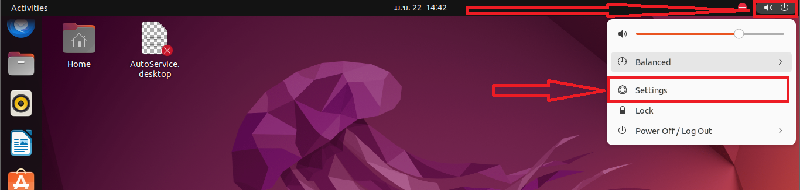

# AutoService Thao tác triển khai đơn giản SOP 

## 1. Cấu hình địa chỉ IP

Trước khi cài đặt AutoService, cần đảm bảo cáp mạng của máy tính đã được kết nối bình thường và địa chỉ IP mạng đã được cấu hình chính xác.

**Bảng địa chỉ IP của dây chuyền đóng gói:**

| 工站 | 设备 | 类型 | 网段 | IP 地址 | 状态 | 连接交换机 | 已分配端口 | 端口号 | 网线标签 |
| :--- | :--- | :--- | :--- | :--- | :--- | :--- | :--- | :--- | :--- |
| 其它 | VISTA数据采集工控机 | IPC | 182.168.1.0/24 | 182.168.1.80 | 正常 | ReFlash交换机 | 是 | 14 | VISTA |
| ReFlash | DUT扫码枪1 | IPC | 182.168.1.0/24 | 182.168.1.15 | 正常 | ReFlash交换机 | 是 | 6 | DUTBar1 |
| ReFlash | DUT扫码枪2 | IPC | 182.168.1.0/24 | 182.168.1.16 | 正常 | ReFlash交换机 | 是 | 7 | DUTBar2 |
| ReFlash | 工站-工控机 | IPC | 182.168.1.0/24 | 182.168.1.12 | 正常 | ReFlash交换机 | 是 | 3 | BUGO |
| ReFlash | 测试机1-工控机 | IPC | 182.168.1.0/24 | 182.168.1.20 | 正常 | ReFlash交换机 | 是 | 8 | Tester1 IPC |
| ReFlash | 测试机2-工控机 | IPC | 182.168.1.0/24 | 182.168.1.21 | 正常 | ReFlash交换机 | 是 | 9 | Tester2 IPC |
| ReFlash | 测试机3-工控机 | IPC | 182.168.1.0/24 | 182.168.1.22 | 正常 | ReFlash交换机 | 是 | 10 | Tester3 IPC |
| ReFlash | 测试机4-工控机 | IPC | 182.168.1.0/24 | 182.168.1.23 | 正常 | ReFlash交换机 | 是 | 11 | Tester4 IPC |
| ReFlash | 测试机5-工控机 | IPC | 182.168.1.0/24 | 182.168.1.24 | 正常 | ReFlash交换机 | 是 | 12 | Tester5 IPC |
| ReFlash | 测试机6-工控机 | IPC | 182.168.1.0/24 | 182.168.1.25 | 正常 | ReFlash交换机 | 是 | 13 | Tester6 IPC |
| ReFlash | HMI | PLC | 182.168.1.0/24 | 182.168.1.11 | 正常 |  | 否 |  | HMI |
| ReFlash | PLC | PLC | 182.168.1.0/24 | 182.168.1.10 | 正常 | ReFlash交换机 | 是 | 4 | PLC |
| ReFlash | Tray扫码枪1 | 其它 | 182.168.1.0/24 | 182.168.1.13 | 正常 |  | 否 |  | TrayBar1 |
| ReFlash | Tray扫码枪2 | 其它 | 182.168.1.0/24 | 182.168.1.14 | 正常 |  | 否 |  | TrayBar2 |
| ReFlash | 虚拟机预留ip1 | 其它 | 182.168.1.0/24 | 182.168.1.26 | 正常 |  | 否 |  |  |
| ReFlash | 虚拟机预留ip2 | 其它 | 182.168.1.0/24 | 182.168.1.27 | 正常 |  | 否 |  |  |
| ReFlash | 工站监控主机 | 图像/监控 | 182.168.1.0/24 | 182.168.1.120 | 正常 | ReFlash交换机 | 是 | 1 | NVR |
| ReFlash | 工站监控器 | 图像/监控 | 182.168.1.0/24 | 182.168.1.2 | 正常 | ReFlash交换机 | 是 | 2 | RCAM |
| QT0 | 工站-工控机 | IPC | 182.168.1.0/24 | 182.168.1.32 | 正常 | QT0-1交换机 | 是 | 1 | BUGO |
| QT0 | 测试机1-工控机 | IPC | 182.168.1.0/24 | 182.168.1.41 | 正常 | QT0-1交换机 | 是 | 2 | Tester1 IPC |
| QT0 | 测试机2-工控机 | IPC | 182.168.1.0/24 | 182.168.1.43 | 正常 | QT0-1交换机 | 是 | 3 | Tester2 IPC |
| QT0 | 测试机3-工控机 | IPC | 182.168.1.0/24 | 182.168.1.45 | 正常 | QT0-1交换机 | 是 | 4 | Tester3 IPC |
| QT0 | 测试机4-工控机 | IPC | 182.168.1.0/24 | 182.168.1.47 | 正常 | QT0-1交换机 | 是 | 5 | Tester4 IPC |
| QT0 | HMI | PLC | 182.168.1.0/24 | 182.168.1.31 | 正常 |  | 否 |  | HMI |
| QT0 | 回流催盘模组PLC | PLC | 182.168.1.0/24 | 182.168.1.38 | 正常 | QT0-2交换机 | 是 | 1 | RCMPLC |
| QT0 | 工站主PLC | PLC | 182.168.1.0/24 | 182.168.1.30 | 正常 | QT0-1交换机 | 是 | 6 | PLC |
| QT0 | 测试机1-PLC | PLC | 182.168.1.0/24 | 182.168.1.40 | 正常 | QT0-1交换机 | 是 | 7 | Tester1 PLC |
| QT0 | 测试机2-PLC | PLC | 182.168.1.0/24 | 182.168.1.42 | 正常 | QT0-1交换机 | 是 | 8 | Tester2 PLC |
| QT0 | 测试机3-PLC | PLC | 182.168.1.0/24 | 182.168.1.44 | 正常 | QT0-1交换机 | 是 | 9 | Tester3 PLC |
| QT0 | 测试机4-PLC | PLC | 182.168.1.0/24 | 182.168.1.46 | 正常 | QT0-1交换机 | 是 | 10 | Tester4 PLC |
| QT0 | 扫码枪 | 其它 | 182.168.1.0/24 | 182.168.1.106 | 正常 | QT0-2交换机 | 是 | 5 | Scanner |
| QT0 | 虚拟机预留ip1 | 其它 | 182.168.1.0/24 | 182.168.1.48 | 正常 |  | 否 |  |  |
| QT0 | 虚拟机预留ip2 | 其它 | 182.168.1.0/24 | 182.168.1.49 | 正常 |  | 否 |  |  |
| QT0 | QT0-1监控 | 图像/监控 | 182.168.1.0/24 | 182.168.1.4 | 正常 | QT0-2交换机 | 是 | 3 | CAM1 |
| QT0 | QT0-2监控 | 图像/监控 | 182.168.1.0/24 | 182.168.1.5 | 正常 | QT0-2交换机 | 是 | 4 | CAM2 |
| QT0 | 工站监控器 | 图像/监控 | 182.168.1.0/24 | 182.168.1.161 | 正常 | QT0-2交换机 | 是 | 2 | CAM |
| MIC1 | 工站-工控机 | IPC | 182.168.1.0/24 | 182.168.1.52 | 正常 | MIC1-1交换机 | 是 | 1 | BUGO |
| MIC1 | 测试机1-工控机 | IPC | 182.168.1.0/24 | 182.168.1.61 | 正常 | MIC1-1交换机 | 是 | 2 | Tester1 IPC |
| MIC1 | 测试机2-工控机 | IPC | 182.168.1.0/24 | 182.168.1.63 | 正常 | MIC1-1交换机 | 是 | 3 | Tester2 IPC |
| MIC1 | 测试机3-工控机 | IPC | 182.168.1.0/24 | 182.168.1.65 | 正常 | MIC1-1交换机 | 是 | 4 | Tester3 IPC |
| MIC1 | 测试机4-工控机 | IPC | 182.168.1.0/24 | 182.168.1.66 | 正常 | MIC1-1交换机 | 是 | 5 | Tester4 IPC |
| MIC1 | HMI | PLC | 182.168.1.0/24 | 182.168.1.51 | 正常 |  | 否 |  | HMI |
| MIC1 | M1-5 | PLC | 182.168.1.0/24 | 182.168.1.59 | 正常 | MIC1-2交换机 | 是 | 6 | M1-5 |
| MIC1 | M1-6 | PLC | 182.168.1.0/24 | 182.168.1.58 | 正常 | MIC1-2交换机 | 是 | 8 | M1-6 |
| MIC1 | M1-7 | PLC | 182.168.1.0/24 | 182.168.1.57 | 正常 | MIC1-2交换机 | 是 | 7 | M1-7 |
| MIC1 | 工站主PLC | PLC | 182.168.1.0/24 | 182.168.1.50 | 正常 | MIC1-2交换机 | 是 | 2 | PLC |
| MIC1 | 测试机1-PLC | PLC | 182.168.1.0/24 | 182.168.1.60 | 正常 | MIC1-2交换机 | 是 | 3 | Tester1 PLC |
| MIC1 | 测试机2-PLC | PLC | 182.168.1.0/24 | 182.168.1.62 | 正常 | MIC1-2交换机 | 是 | 4 | Tester2 PLC |
| MIC1 | DUT扫码枪1 | 其它 | 182.168.1.0/24 | 182.168.1.53 | 正常 |  | 否 |  | DUTBar1 |
| MIC1 | DUT扫码枪2 | 其它 | 182.168.1.0/24 | 182.168.1.54 | 正常 |  | 否 |  | DUTBar2 |
| MIC1 | 虚拟机预留ip1 | 其它 | 182.168.1.0/24 | 182.168.1.64 | 正常 |  | 否 |  |  |
| MIC1 | 视觉虚拟机 | 其它 | 182.168.1.0/24 | 182.168.1.254 | 正常 |  | 否 |  |  |
| MIC1 | MIC1监控 | 图像/监控 | 182.168.1.0/24 | 182.168.1.3 | 正常 | MIC1-2交换机 | 是 | 5 | M1CAM |
|  | 监控主机 | 工控机 | 192.168.1.0/24 | 192.168.1.168 | 正常 | SW17 | 是 | 15 | CAMIPC |
|  | 海康摄像头1 | 摄像头 | 192.168.1.0/24 | 192.168.1.2 | 正常 | SW16 | 是 | 5 | CAM1 |
|  | 海康摄像头2 | 摄像头 | 192.168.1.0/24 | 192.168.1.3 | 正常 | SW16 | 是 | 6 | CAM2 |
| 上料工位 | 工站-工控机1 | 工控机 | 192.168.1.0/24 | 192.168.1.10 | 正常 |  | 否 |  |  |
| 上料工位 | 上料位扫码枪(1) | 扫码枪 | 192.168.1.0/24 | 192.168.1.11 | 正常 | SW16 | 是 | 9 | SCAN1 |
| Prov工位(入料+出料) | 测试机1-工控机 | 工控机 | 192.168.1.0/24 | 192.168.1.32 | 正常 | SW17 | 是 | 1 | TestIPC1 |
| Prov工位(入料+出料) | 测试机2-工控机 | 工控机 | 192.168.1.0/24 | 192.168.1.33 | 正常 | SW17 | 是 | 2 | TestIPC2 |
| Prov工位(入料+出料) | 测试机3-工控机 | 工控机 | 192.168.1.0/24 | 192.168.1.34 | 正常 | SW17 | 是 | 3 | TestIPC3 |
| Prov工位(入料+出料) | 测试机4-工控机 | 工控机 | 192.168.1.0/24 | 192.168.1.35 | 正常 | SW17 | 是 | 4 | TestIPC4 |
| Prov工位(入料+出料) | 测试机5-工控机 | 工控机 | 192.168.1.0/24 | 192.168.1.36 | 正常 | SW17 | 是 | 5 | TestIPC5 |
| Prov工位(入料+出料) | 测试机6-工控机 | 工控机 | 192.168.1.0/24 | 192.168.1.37 | 正常 | SW17 | 是 | 6 | TestIPC6 |
| Prov工位(入料+出料) | 测试机7-工控机 | 工控机 | 192.168.1.0/24 | 192.168.1.38 | 正常 | SW17 | 是 | 7 | TestIPC7 |
| Prov工位(入料+出料) | 测试机8-工控机 | 工控机 | 192.168.1.0/24 | 192.168.1.39 | 正常 | SW17 | 是 | 8 | TestIPC8 |
| Prov工位(入料+出料) | 工站-工控机2 | 工控机 | 192.168.1.0/24 | 192.168.1.30 | 正常 | SW16 | 是 | 2 | IPC2 |
| Prov工位(入料+出料) | Frst进站前扫码枪(3) | 扫码枪 | 192.168.1.0/24 | 192.168.1.40 | 正常 | SW16 | 是 | 11 | PROVSCAN3 |
| Prov工位(入料+出料) | Prov进站前扫码枪(2) | 扫码枪 | 192.168.1.0/24 | 192.168.1.31 | 正常 | SW16 | 是 | 10 | PROVSCAN2 |
| Prov工位(入料+出料) | HMI | HMI | 192.168.1.0/24 | 192.168.1.98 | 正常 |  | 否 |  |  |
| Prov工位(入料+出料) | 工站主PLC | PLC | 192.168.1.0/24 | 192.168.1.88 | 正常 | SW16 | 是 | 1 | PLC |
| Freset工位 | 工站-工控机3 | 工控机 | 192.168.1.0/24 | 192.168.1.50 | 正常 |  | 否 |  |  |
| Freset工位 | 右Frst工位_测试机13-工控机 | 工控机 | 192.168.1.0/24 | 192.168.1.55 | 正常 |  | 否 |  |  |
| Freset工位 | 右Frst工位_测试机14-工控机 | 工控机 | 192.168.1.0/24 | 192.168.1.56 | 正常 |  | 否 |  |  |
| Freset工位 | 右Frst工位_测试机15-工控机 | 工控机 | 192.168.1.0/24 | 192.168.1.57 | 正常 |  | 否 |  |  |
| Freset工位 | 右Frst工位_测试机16-工控机 | 工控机 | 192.168.1.0/24 | 192.168.1.58 | 正常 |  | 否 |  |  |
| Freset工位 | 左Frst工位_测试机9-工控机 | 工控机 | 192.168.1.0/24 | 192.168.1.51 | 正常 | SW17 | 是 | 9 | LTESTPC9 |
| Freset工位 | 左Frst工位_测试机10-工控机 | 工控机 | 192.168.1.0/24 | 192.168.1.52 | 正常 | SW17 | 是 | 10 | LTESTPC10 |
| Freset工位 | 左Frst工位_测试机11-工控机 | 工控机 | 192.168.1.0/24 | 192.168.1.53 | 正常 | SW17 | 是 | 11 | LTESTPC11 |
| Freset工位 | 左Frst工位_测试机12-工控机 | 工控机 | 192.168.1.0/24 | 192.168.1.54 | 正常 | SW17 | 是 | 12 | LTESTPC12 |
| Freset工位 | 右Frst工位扫码枪(5) | 扫码枪 | 192.168.1.0/24 | 192.168.1.62 | 正常 | SW17 | 是 | 14 | RFRSTSCAN5 |
| Freset工位 | 左Frst工位扫码枪(4) | 扫码枪 | 192.168.1.0/24 | 192.168.1.61 | 正常 | SW17 | 是 | 13 | LFRSTSCAN4 |
| 下料工位 | 下料工位预留 | 预留 | 192.168.1.0/24 | 192.168.1.60 | 正常 |  | 否 |  |  |
| 21UDFPS摄像头 | 其它 | 图像/监控 | 182.168.9.0/24 | 182.168.9.0/24 | 182.168.9.12 | 否 |  | 00汇聚交换机 | UDFPS-CAM |
| 22QT1M+QT2M摄像头 | 其它 | 图像/监控 | 182.168.9.0/24 | 182.168.9.0/24 | 182.168.9.10 | 否 |  | 00汇聚交换机 | QT-CAM |
| 23Audio combo摄像头 | 其它 | 图像/监控 | 182.168.9.0/24 | 182.168.9.0/24 | 182.168.9.11 | 否 |  | 00汇聚交换机 | AUDIO-CAM |
| 24RF-WBT RF-CELL摄像头 | 其它 | 图像/监控 | 182.168.9.0/24 | 182.168.9.0/24 | 182.168.9.13 | 否 |  | 00汇聚交换机 | WBT-CAM |
| 大屏跳板机 | 其它 | 其它 | 182.168.9.0/24 | 182.168.9.0/24 | 182.168.9.50 | 否 |  | 01Runin交换机 | LSJS |
| 监控录像机 | 其它 | 图像/监控 | 182.168.9.0/24 | 182.168.9.0/24 | 182.168.9.252 | 否 |  | 00汇聚交换机 | WLVR |
| 02Runin摄像头1 | runin auto | 图像/监控 | 182.168.9.0/24 | 182.168.9.0/24 | 182.168.9.14 | 否 |  | 01Runin交换机 | CAM1 |
| 02Runin摄像头2 | runin auto | 图像/监控 | 182.168.9.0/24 | 182.168.9.0/24 | 182.168.9.15 | 否 |  | 01Runin交换机 | CAM2 |
| HMI | runin auto | PLC | 182.168.9.0/24 | 182.168.9.0/24 | 182.168.9.89 | 否 |  | 01Runin交换机 | HMI |
| RuninAuto工控机 | runin auto | IPC | 182.168.9.0/24 | 182.168.9.0/24 | 182.168.9.90 | 否 |  | 00汇聚交换机 | AUTO-BUGO |
| 上料右智能相机 | runin auto | 图像/测试 | 182.168.9.0/24 | 182.168.9.0/24 | 182.168.9.97 | 否 |  | 01Runin交换机 | LoadRightCAM |
| 上料左智能相机 | runin auto | 图像/测试 | 182.168.9.0/24 | 182.168.9.0/24 | 182.168.9.98 | 否 |  | 01Runin交换机 | LoadLeftCAM |
| 主PLC | runin auto | PLC | 182.168.9.0/24 | 182.168.9.0/24 | 182.168.9.80 | 否 |  | 01Runin交换机 | PLC |
| 右边副PLC | runin auto | PLC | 182.168.9.0/24 | 182.168.9.0/24 | 182.168.9.84 | 否 |  | 01Runin交换机 | RPLC |
| 后段智能相机右 | runin auto | 其它 | 182.168.9.0/24 | 182.168.9.0/24 | 182.168.9.83 | 否 |  | 01Runin交换机 | RearRightCAM |
| 后段智能相机左 | runin auto | 图像/测试 | 182.168.9.0/24 | 182.168.9.0/24 | 182.168.9.82 | 否 |  | 01Runin交换机 | RearLeftCAM |
| 左边副PLC | runin auto | PLC | 182.168.9.0/24 | 182.168.9.0/24 | 182.168.9.85 | 否 |  | 01Runin交换机 | LPLC |
| 机械手 | runin auto | PLC | 182.168.9.0/24 | 182.168.9.0/24 | 182.168.9.81 | 否 |  | 01Runin交换机 | ROBOT |
| 机械手上的相机 | runin auto | 图像/测试 | 182.168.9.0/24 | 182.168.9.0/24 | 182.168.9.86 | 否 |  | 01Runin交换机 | ROBCAM |
| 机械手用在流水线相机 | runin auto | 其它 | 182.168.9.0/24 | 182.168.9.0/24 | 182.168.9.87 | 否 |  |  | ROBFLOWCAM |
| 03撕膜机摄像头 | 撕膜机 | 图像/监控 | 182.168.9.0/24 | 182.168.9.0/24 | 182.168.9.9 | 否 |  | 02撕膜交换机 | CAM |
| HMI | 撕膜机 | PLC | 182.168.9.0/24 | 182.168.9.0/24 | 182.168.9.96 | 否 |  | 02撕膜交换机 | HMI |
| 主PLC | 撕膜机 | PLC | 182.168.9.0/24 | 182.168.9.0/24 | 182.168.9.95 | 否 |  | 02撕膜交换机 | PLC |
| 04清洁摄像头 | 清洁 | 图像/监控 | 182.168.9.0/24 | 182.168.9.0/24 | 182.168.9.16 | 否 |  | 03清洁交换机 | CAM |
| HMI | 清洁 | PLC | 182.168.9.0/24 | 182.168.9.0/24 | 182.168.9.52 | 否 |  | 03清洁交换机 | HMI |
| 主PLC | 清洁 | PLC | 182.168.9.0/24 | 182.168.9.0/24 | 182.168.9.51 | 否 |  | 03清洁交换机 | PLC |
| 04AOI摄像头 | AOI | 图像/监控 | 182.168.9.0/24 | 182.168.9.0/24 | 182.168.9.102 | 否 |  | 04AOI交换机 | CAM |
| HMI | AOI | PLC | 182.168.9.0/24 | 182.168.9.0/24 | 182.168.9.101 | 否 |  | 04AOI交换机 | HMI |
| PLC | AOI | PLC | 182.168.9.0/24 | 182.168.9.0/24 | 182.168.9.100 | 否 |  | 04AOI交换机 | PLC |
| RuninAOI工控机 | AOI | IPC | 182.168.9.0/24 | 182.168.9.0/24 | 182.168.9.105 | 否 |  | 04AOI交换机 | IPC |
| 线头工控机 | AOI | IPC | 182.168.9.0/24 | 182.168.9.0/24 | 182.168.9.104 | 否 |  | 00汇聚交换机 | Server |
| 虚拟ip节点 | AOI | 其它 | 182.168.9.0/24 | 182.168.9.0/24 | 182.168.9.103 | 否 |  |  |  |
| 06DsCombo摄像头 | DsCombo | 图像/监控 | 182.168.9.0/24 | 182.168.9.0/24 | 182.168.9.7 | 否 |  | 05DsCombo交换机 | CDS-CAM |
| DsCombo工控机 | DsCombo | IPC | 182.168.9.0/24 | 182.168.9.0/24 | 182.168.9.115 | 否 |  | 00汇聚交换机 | CDS-BUGO |
| HMI | DsCombo | PLC | 182.168.9.0/24 | 182.168.9.0/24 | 182.168.9.112 | 否 |  | 05DsCombo交换机 | HMI |
| 主PLC | DsCombo | PLC | 182.168.9.0/24 | 182.168.9.0/24 | 182.168.9.110 | 否 |  | 05DsCombo交换机 | PLC |
| 机械手 | DsCombo | PLC | 182.168.9.0/24 | 182.168.9.0/24 | 182.168.9.113 | 否 |  | 05DsCombo交换机 | ROBOT |
| 机械手相机 | DsCombo | 图像/测试 | 182.168.9.0/24 | 182.168.9.0/24 | 182.168.9.114 | 否 |  | 05DsCombo交换机 | ROBCAM |
| 测试机1 HMI | DsCombo | PLC | 182.168.9.0/24 | 182.168.9.0/24 | 182.168.9.122 | 否 |  |  | Tester1 HMI |
| 测试机1 PLC1 | DsCombo | PLC | 182.168.9.0/24 | 182.168.9.0/24 | 182.168.9.120 | 否 |  | 05DsCombo交换机 | Tester1 PLC1 |
| 测试机1 PLC2 | DsCombo | PLC | 182.168.9.0/24 | 182.168.9.0/24 | 182.168.9.123 | 否 |  | 05DsCombo交换机 | 测试机1PLC2 |
| 测试机1工控机 | DsCombo | IPC | 182.168.9.0/24 | 182.168.9.0/24 | 182.168.9.121 | 否 |  | 05DsCombo交换机 | Tester1 IPC |
| 测试机2 PLC1 | DsCombo | PLC | 182.168.9.0/24 | 182.168.9.0/24 | 182.168.9.125 | 否 |  | 05DsCombo交换机 | Tester2 PLC1 |
| 测试机2 PLC2 | DsCombo | PLC | 182.168.9.0/24 | 182.168.9.0/24 | 182.168.9.128 | 否 |  | 05DsCombo交换机 | Tester2 PLC2 |
| 测试机2工控机 | DsCombo | IPC | 182.168.9.0/24 | 182.168.9.0/24 | 182.168.9.124 | 否 |  | 05DsCombo交换机 | Tester2 IPC |
| 测试机3 HMI | DsCombo | PLC | 182.168.9.0/24 | 182.168.9.0/24 | 182.168.9.127 | 否 |  |  | Tester3 HMI |
| 测试机3工控机 | DsCombo | IPC | 182.168.9.0/24 | 182.168.9.0/24 | 182.168.9.129 | 否 |  | 05DsCombo交换机 | Tester3 IPC |
| 测试机4工控机 | DsCombo | IPC | 182.168.9.0/24 | 182.168.9.0/24 | 182.168.9.126 | 否 |  | 05DsCombo交换机 | Tester4 IPC |
| 皮带线PLC | DsCombo | PLC | 182.168.9.0/24 | 182.168.9.0/24 | 182.168.9.111 | 否 |  | 05DsCombo交换机 | BELTPLC |
| 虚拟机预留ip1 | DsCombo | 其它 | 182.168.9.0/24 | 182.168.9.0/24 | 182.168.9.119 | 否 |  |  | VIP |
| UDFPSPLC | BOJAY | PLC | 182.168.9.0/24 | 182.168.9.0/24 | 182.168.9.42 | 否 |  | 00汇聚交换机 | UDFPS-PLC |
| UDFPS工控机 | BOJAY | IPC | 182.168.9.0/24 | 182.168.9.0/24 | 182.168.9.41 | 否 |  | 00汇聚交换机 | UDFPS-IPC |
| UDFPS机械手 | BOJAY | PLC | 182.168.9.0/24 | 182.168.9.0/24 | 182.168.9.43 | 否 |  | 00汇聚交换机 | UDFPS-ROB |
| UDFPS测试机 | BOJAY | IPC | 182.168.9.0/24 | 182.168.9.0/24 | 182.168.9.44 | 否 |  | 00汇聚交换机 | UDFPS-Tester |
| 数据库虚拟IP | BOJAY | IPC | 182.168.9.0/24 | 182.168.9.0/24 | 182.168.9.70 | 否 |  |  |  |
| 14OIS摄像头 | OIS | 图像/监控 | 182.168.9.0/24 | 182.168.9.0/24 | 182.168.9.19 | 否 |  | 07OIS交换机 | OIS-CAM |
| HMI | OIS | PLC | 182.168.9.0/24 | 182.168.9.0/24 | 182.168.9.132 | 否 |  | 07OIS交换机 | HMI |
| OIS工控机 | OIS | IPC | 182.168.9.0/24 | 182.168.9.0/24 | 182.168.9.135 | 否 |  | 00汇聚交换机 | OIS-BUGO |
| WT-1电脑 | OIS | IPC | 182.168.9.0/24 | 182.168.9.0/24 | 182.168.9.136 | 否 |  | 07OIS交换机 | Tester1 IPC |
| WT-2电脑 | OIS | IPC | 182.168.9.0/24 | 182.168.9.0/24 | 182.168.9.137 | 否 |  | 07OIS交换机 | Tester2 IPC |
| 主PLC | OIS | PLC | 182.168.9.0/24 | 182.168.9.0/24 | 182.168.9.130 | 否 |  | 07OIS交换机 | PLC |
| 机械手 | OIS | PLC | 182.168.9.0/24 | 182.168.9.0/24 | 182.168.9.133 | 否 |  | 07OIS交换机 | ROBOT |
| 机械手上的相机 | OIS | 图像/测试 | 182.168.9.0/24 | 182.168.9.0/24 | 182.168.9.134 | 否 |  | 07OIS交换机 | ROBCAM |
| 皮带线PLC | OIS | PLC | 182.168.9.0/24 | 182.168.9.0/24 | 182.168.9.131 | 否 |  | 07OIS交换机 | BELTPLC |
| 虚拟机预留ip1 | OIS | 其它 | 182.168.9.0/24 | 182.168.9.0/24 | 182.168.9.138 | 否 |  |  | VIP1 |
| 虚拟机预留ip2 | OIS | 其它 | 182.168.9.0/24 | 182.168.9.0/24 | 182.168.9.139 | 否 |  |  | VIP2 |
| 08Combo2摄像头 | Combo2 | 图像/监控 | 182.168.9.0/24 | 182.168.9.0/24 | 182.168.9.3 | 否 |  | 08Combo2交换机 | COMBO2-CAM |
| Combo2工控机 | Combo2 | IPC | 182.168.9.0/24 | 182.168.9.0/24 | 182.168.9.145 | 否 |  | 00汇聚交换机 | COMBO2-BUGO |
| HMI | Combo2 | PLC | 182.168.9.0/24 | 182.168.9.0/24 | 182.168.9.142 | 否 |  | 08Combo2交换机 | HMI |
| 主PLC | Combo2 | PLC | 182.168.9.0/24 | 182.168.9.0/24 | 182.168.9.140 | 否 |  | 08Combo2交换机 | PLC |
| 机械手 | Combo2 | PLC | 182.168.9.0/24 | 182.168.9.0/24 | 182.168.9.143 | 否 |  | 08Combo2交换机 | ROBOT |
| 机械手上的相机 | Combo2 | 图像/测试 | 182.168.9.0/24 | 182.168.9.0/24 | 182.168.9.144 | 否 |  | 08Combo2交换机 | ROBCAM |
| 测试机1 HMI | Combo2 | PLC | 182.168.9.0/24 | 182.168.9.0/24 | 182.168.9.158 | 否 |  |  | Tester1 HMI |
| 测试机1 PLC | Combo2 | PLC | 182.168.9.0/24 | 182.168.9.0/24 | 182.168.9.154 | 否 |  | 08Combo2交换机 | Tester1 PLC |
| 测试机1电脑 | Combo2 | IPC | 182.168.9.0/24 | 182.168.9.0/24 | 182.168.9.150 | 否 |  | 08Combo2交换机 | Tester1 IPC |
| 测试机2 HMI | Combo2 | PLC | 182.168.9.0/24 | 182.168.9.0/24 | 182.168.9.159 | 否 |  |  | Tester2 HMI |
| 测试机2 PLC | Combo2 | PLC | 182.168.9.0/24 | 182.168.9.0/24 | 182.168.9.155 | 否 |  | 08Combo2交换机 | Tester2 PLC |
| 测试机2电脑 | Combo2 | IPC | 182.168.9.0/24 | 182.168.9.0/24 | 182.168.9.151 | 否 |  | 08Combo2交换机 | Tester2 IPC |
| 测试机3 HMI | Combo2 | PLC | 182.168.9.0/24 | 182.168.9.0/24 | 182.168.9.160 | 否 |  |  | Tester3 HMI |
| 测试机3 PLC | Combo2 | PLC | 182.168.9.0/24 | 182.168.9.0/24 | 182.168.9.156 | 否 |  | 08Combo2交换机 | Tester3 PLC |
| 测试机3电脑 | Combo2 | IPC | 182.168.9.0/24 | 182.168.9.0/24 | 182.168.9.152 | 否 |  | 08Combo2交换机 | Tester3 IPC |
| 测试机4 HMI | Combo2 | PLC | 182.168.9.0/24 | 182.168.9.0/24 | 182.168.9.161 | 否 |  |  | Tester4 HMI |
| 测试机4 PLC | Combo2 | PLC | 182.168.9.0/24 | 182.168.9.0/24 | 182.168.9.157 | 否 |  | 08Combo2交换机 | Tester4 PLC |
| 测试机4电脑 | Combo2 | IPC | 182.168.9.0/24 | 182.168.9.0/24 | 182.168.9.153 | 否 |  | 08Combo2交换机 | Tester4 IPC |
| 皮带线PLC | Combo2 | PLC | 182.168.9.0/24 | 182.168.9.0/24 | 182.168.9.141 | 否 |  | 08Combo2交换机 | BELTPLC |
| 虚拟机预留ip1 | Combo2 | 其它 | 182.168.9.0/24 | 182.168.9.0/24 | 182.168.9.162 | 否 |  |  | VIP1 |
| 虚拟机预留ip2 | Combo2 | 其它 | 182.168.9.0/24 | 182.168.9.0/24 | 182.168.9.163 | 否 |  |  | VIP2 |
| 09Combo3摄像头 | Combo3 | 图像/监控 | 182.168.9.0/24 | 182.168.9.0/24 | 182.168.9.2 | 否 |  | 09Combo3交换机 | COMBO3-CAM |
| Combo3工控机 | Combo3 | IPC | 182.168.9.0/24 | 182.168.9.0/24 | 182.168.9.175 | 否 |  | 00汇聚交换机 | COMBO3-BUGO |
| HMI | Combo3 | PLC | 182.168.9.0/24 | 182.168.9.0/24 | 182.168.9.172 | 否 |  | 09Combo3交换机 | HMI |
| 主PLC | Combo3 | PLC | 182.168.9.0/24 | 182.168.9.0/24 | 182.168.9.170 | 否 |  | 09Combo3交换机 | PLC |
| 机械手 | Combo3 | PLC | 182.168.9.0/24 | 182.168.9.0/24 | 182.168.9.173 | 否 |  | 09Combo3交换机 | ROBOT |
| 机械手上的相机 | Combo3 | 图像/测试 | 182.168.9.0/24 | 182.168.9.0/24 | 182.168.9.174 | 否 |  | 09Combo3交换机 | ROBCAM |
| 测试机1 HMI | Combo3 | PLC | 182.168.9.0/24 | 182.168.9.0/24 | 182.168.9.188 | 否 |  |  | Tester1 HMI |
| 测试机1 PLC | Combo3 | PLC | 182.168.9.0/24 | 182.168.9.0/24 | 182.168.9.184 | 否 |  | 09Combo3交换机 | Tester1 PLC |
| 测试机1电脑 | Combo3 | IPC | 182.168.9.0/24 | 182.168.9.0/24 | 182.168.9.180 | 否 |  | 09Combo3交换机 | Tester1 IPC |
| 测试机2 HMI | Combo3 | PLC | 182.168.9.0/24 | 182.168.9.0/24 | 182.168.9.189 | 否 |  |  | Tester2 HMI |
| 测试机2 PLC | Combo3 | PLC | 182.168.9.0/24 | 182.168.9.0/24 | 182.168.9.185 | 否 |  | 09Combo3交换机 | Tester2 PLC |
| 测试机2电脑 | Combo3 | IPC | 182.168.9.0/24 | 182.168.9.0/24 | 182.168.9.181 | 否 |  | 09Combo3交换机 | Tester2 IPC |
| 测试机3 HMI | Combo3 | PLC | 182.168.9.0/24 | 182.168.9.0/24 | 182.168.9.190 | 否 |  |  | Tester3 HMI |
| 测试机3 PLC | Combo3 | PLC | 182.168.9.0/24 | 182.168.9.0/24 | 182.168.9.186 | 否 |  | 09Combo3交换机 | Tester3 PLC |
| 测试机3电脑 | Combo3 | IPC | 182.168.9.0/24 | 182.168.9.0/24 | 182.168.9.182 | 否 |  | 09Combo3交换机 | Tester3 IPC |
| 测试机4 HMI | Combo3 | PLC | 182.168.9.0/24 | 182.168.9.0/24 | 182.168.9.191 | 否 |  |  | Tester4 HMI |
| 测试机4 PLC | Combo3 | PLC | 182.168.9.0/24 | 182.168.9.0/24 | 182.168.9.187 | 否 |  | 09Combo3交换机 | Tester4 PLC |
| 测试机4电脑 | Combo3 | IPC | 182.168.9.0/24 | 182.168.9.0/24 | 182.168.9.183 | 否 |  | 09Combo3交换机 | Tester4 IPC |
| 皮带线PLC | Combo3 | PLC | 182.168.9.0/24 | 182.168.9.0/24 | 182.168.9.171 | 否 |  | 09Combo3交换机 | BELTPLC |
| 虚拟机预留ip1 | Combo3 | 其它 | 182.168.9.0/24 | 182.168.9.0/24 | 182.168.9.192 | 否 |  |  | VIP1 |
| 虚拟机预留ip2 | Combo3 | 其它 | 182.168.9.0/24 | 182.168.9.0/24 | 182.168.9.193 | 否 |  |  | VIP2 |
| 12IMU6摄像头 | IMU6 | 图像/监控 | 182.168.9.0/24 | 182.168.9.0/24 | 182.168.9.4 | 否 |  | 10IMU6交换机 | IMU6-CAM |
| HMI | IMU6 | PLC | 182.168.9.0/24 | 182.168.9.0/24 | 182.168.9.202 | 否 |  | 10IMU6交换机 | HMI |
| IMU6-1 HMI | IMU6 | PLC | 182.168.9.0/24 | 182.168.9.0/24 | 182.168.9.214 | 否 |  | 10IMU6交换机 | Tester1 HMI |
| IMU6-1 PLC | IMU6 | PLC | 182.168.9.0/24 | 182.168.9.0/24 | 182.168.9.212 | 否 |  | 10IMU6交换机 | Tester1 PLC |
| IMU6-1电脑 | IMU6 | IPC | 182.168.9.0/24 | 182.168.9.0/24 | 182.168.9.210 | 否 |  | 10IMU6交换机 | Tester1 IPC |
| IMU6-2 HMI | IMU6 | PLC | 182.168.9.0/24 | 182.168.9.0/24 | 182.168.9.215 | 否 |  | 10IMU6交换机 | Tester2 HMI |
| IMU6-2 PLC | IMU6 | PLC | 182.168.9.0/24 | 182.168.9.0/24 | 182.168.9.213 | 否 |  | 10IMU6交换机 | Tester2 PLC |
| IMU6-2电脑 | IMU6 | IPC | 182.168.9.0/24 | 182.168.9.0/24 | 182.168.9.211 | 否 |  | 10IMU6交换机 | Tester2 IPC |
| IMU6工控机 | IMU6 | IPC | 182.168.9.0/24 | 182.168.9.0/24 | 182.168.9.205 | 否 |  | 00汇聚交换机 | IMU6-BUGO |
| 主PLC | IMU6 | PLC | 182.168.9.0/24 | 182.168.9.0/24 | 182.168.9.200 | 否 |  | 10IMU6交换机 | PLC |
| 机械手 | IMU6 | PLC | 182.168.9.0/24 | 182.168.9.0/24 | 182.168.9.203 | 否 |  | 10IMU6交换机 | ROBOT |
| 机械手上的相机 | IMU6 | 图像/测试 | 182.168.9.0/24 | 182.168.9.0/24 | 182.168.9.204 | 否 |  | 10IMU6交换机 | ROBCAM |
| 皮带线PLC | IMU6 | PLC | 182.168.9.0/24 | 182.168.9.0/24 | 182.168.9.201 | 否 |  | 10IMU6交换机 | BELTPLC |
| 虚拟机预留ip1 | IMU6 | 其它 | 182.168.9.0/24 | 182.168.9.0/24 | 182.168.9.216 | 否 |  |  | VIP1 |
| 虚拟机预留ip2 | IMU6 | 其它 | 182.168.9.0/24 | 182.168.9.0/24 | 182.168.9.217 | 否 |  |  | VIP2 |
| 13IMUT摄像头 | IMUT | 图像/监控 | 182.168.9.0/24 | 182.168.9.0/24 | 182.168.9.6 | 否 |  | 11IMUT交换机 | IMUT-CAM |
| HMI | IMUT | PLC | 182.168.9.0/24 | 182.168.9.0/24 | 182.168.9.222 | 否 |  | 11IMUT交换机 | HMI |
| IMUT-1电脑 | IMUT | IPC | 182.168.9.0/24 | 182.168.9.0/24 | 182.168.9.218 | 否 |  | 11IMUT交换机 | Tester1 IPC |
| IMUT-2电脑 | IMUT | IPC | 182.168.9.0/24 | 182.168.9.0/24 | 182.168.9.219 | 否 |  | 11IMUT交换机 | Tester2 IPC |
| IMUT-3电脑 | IMUT | IPC | 182.168.9.0/24 | 182.168.9.0/24 | 182.168.9.227 | 否 |  | 11IMUT交换机 | Tester3 IPC |
| IMUT-4电脑 | IMUT | IPC | 182.168.9.0/24 | 182.168.9.0/24 | 182.168.9.226 | 否 |  | 11IMUT交换机 | Tester4 IPC |
| IMUT工控机 | IMUT | IPC | 182.168.9.0/24 | 182.168.9.0/24 | 182.168.9.225 | 否 |  | 00汇聚交换机 | IMUT-BUGO |
| 主PLC | IMUT | PLC | 182.168.9.0/24 | 182.168.9.0/24 | 182.168.9.220 | 否 |  | 11IMUT交换机 | PLC |
| 机械手 | IMUT | PLC | 182.168.9.0/24 | 182.168.9.0/24 | 182.168.9.223 | 否 |  | 11IMUT交换机 | ROBOT |
| 机械手上的相机 | IMUT | 图像/测试 | 182.168.9.0/24 | 182.168.9.0/24 | 182.168.9.224 | 否 |  | 11IMUT交换机 | ROBCAM |
| 皮带线PLC | IMUT | PLC | 182.168.9.0/24 | 182.168.9.0/24 | 182.168.9.221 | 否 |  | 11IMUT交换机 | BELTPLC |
| 虚拟机预留ip1 | IMUT | 其它 | 182.168.9.0/24 | 182.168.9.0/24 | 182.168.9.228 | 否 |  |  | VIP1 |
| 虚拟机预留ip2 | IMUT | 其它 | 182.168.9.0/24 | 182.168.9.0/24 | 182.168.9.229 | 否 |  |  | VIP2 |

### Các bước thực hiện:
1. Nhấn vào góc trên bên phải màn hình, chọn **Settings**. 

2. Tìm mục **Network**, nhấp vào nút cài đặt mạng và truy cập vào đó *(tại đây sẽ hiển thị hai tùy chọn mạng, một là `CVC`, còn tùy chọn chúng ta cần cài đặt là `AutoService`)*.
3. Nhấn chọn **IPv4**, tích vào tùy chọn **Manual**, điền địa chỉ IP của máy kiểm thử tương ứng vào ô **Address** phía dưới, nhập `24` vào mục **Netmask**, rồi nhấn **Apply** để lưu lại.

---

## 2. Cài đặt AutoService

1. Tìm gói nén `AutoService` (`AutoService.zip`), nếu không có thì bạn có thể nén một bản sao từ thiết bị đang hoạt động bình thường khác rồi mang sang. Đặt gói nén `AutoService` vào thư mục **Home** và giải nén nó.
2. Truy cập thư mục `AutoService`, tìm tệp nén `AutoServiceWeb_whl.zip` rồi giải nén tệp đó.
3. Truy cập vào thư mục `AutoServiceWeb_whl`, sau đó tiếp tục truy cập vào thư mục `web_whl`, nhấp chuột phải chọn **Open in Terminal**, nhập lệnh sau rồi nhấn phím **Enter**:
   ```bash
   bash run.sh
   ```
4. Quay lại thư mục `AutoService`, tìm tệp `AutoService.desktop` và sao chép nó vào thư mục **Desktop** nằm trong thư mục **Home**.
5. Nhấp đúp chuột vào tệp `AutoService.desktop` và tìm dòng đường dẫn bên dưới. Đây là đường dẫn thực thi của AutoService; nếu đường dẫn không đúng, bạn sẽ không thể mở được ứng dụng:
   ```ini
   Exec=bash /home/sta5fatpflashre010/AutoService/AutoService.sh
   ```
6. Quay lại thư mục `AutoService`, nhấn tổ hợp phím `Ctrl + L` để hiển thị đường dẫn của thư mục hiện tại *(ví dụ: `/home/innorev/AutoService/`)*, sau đó sao chép đường dẫn này.
7. Thay thế đường dẫn trong tệp `AutoService.desktop`, sau đó lưu và thoát:
   ```ini
   Exec=bash /home/innorev/AutoService/AutoService.sh
   ```
8. Quay lại màn hình chính, bạn sẽ thấy tệp `AutoService.desktop` xuất hiện. Hãy nhấp chuột phải vào tệp này, chọn mục **Allow Launching**, sau đó bạn có thể khởi chạy AutoService bình thường.

---

## 3. Khác

> **Lưu ý:** Để AutoService hoạt động bình thường, tất cả cấu hình của **Mars** phải chính xác; nếu không, hệ thống sẽ hiển thị thông báo lỗi.
