Bước 1: Giải nén file zip, sau đó giải nén file scan.zip
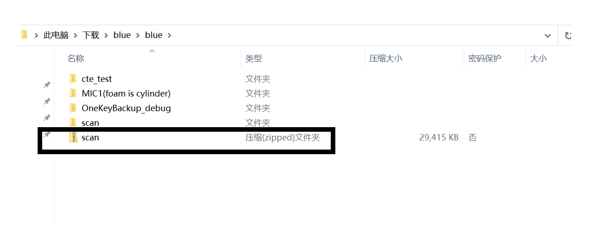

Bước 2: Giải nén file SeriesXSeuic, file docx là file SOP 
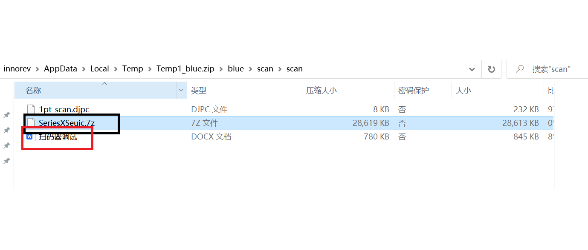

Bước 3: Mở file CodeScanPCSoftware_V3.0.0.20(20230921)_X64 tìm và run file SeriesXsuic.exe (file SeriesXsuic..config dùng để đổi ngôn ngữ sang tiếng anh). Nếu muốn đổi ngôn ngữ sang tiếng anh tìm trong config chuyển 1 thành 0)
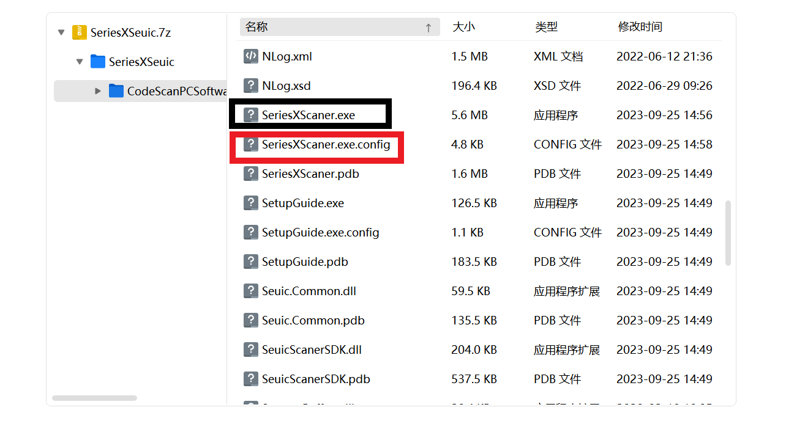

Bước 4: Mở phần mềm quét QR
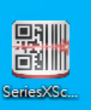

Bước 5: Thiết lập cấu hình mạng của máy quét mã vạch thành 192.168.0.1.
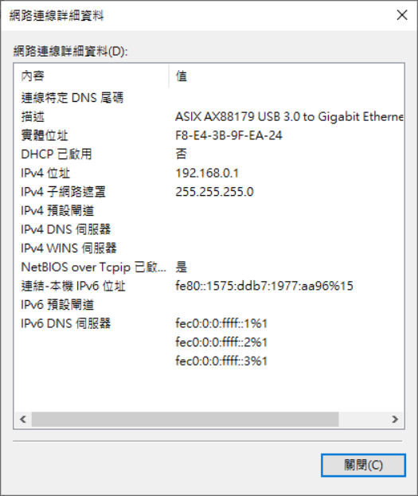

Bước 6: Nhấp vào mạng của máy quét, sau đó nhấp vào làm mới.
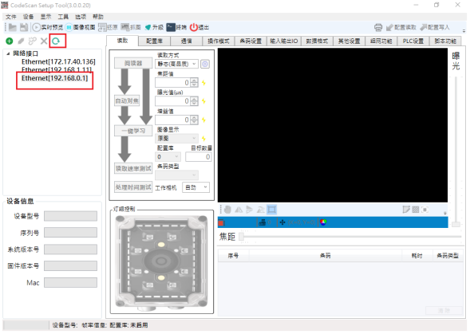

Bước 7: Nhấp đúp để kết nối máy quét mã vạch
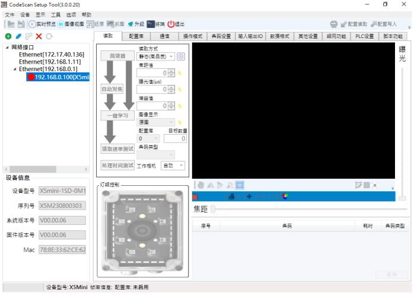

Bước 8: Nhấp vào "File", sau đó chọn "Open" và chọn tệp cấu hình đã được thiết lập tại hiện trường.
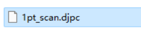

Nếu việc nhập cấu hình không thành công, vui lòng tham khảo các thiết lập hiển thị trong hình ảnh dưới đây.
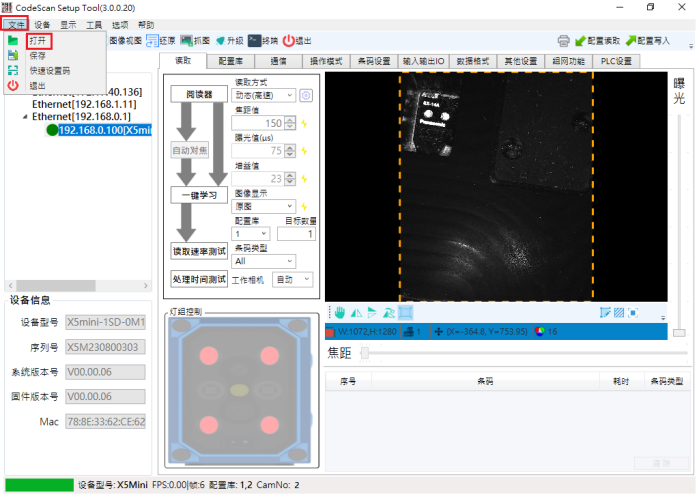
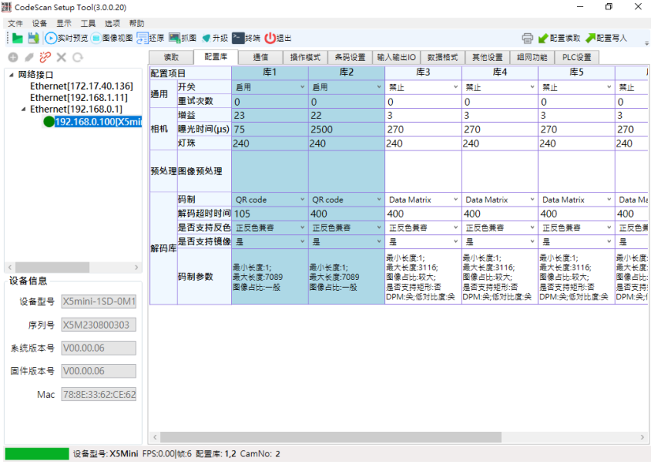
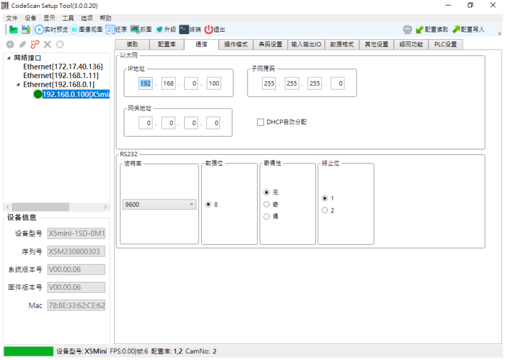
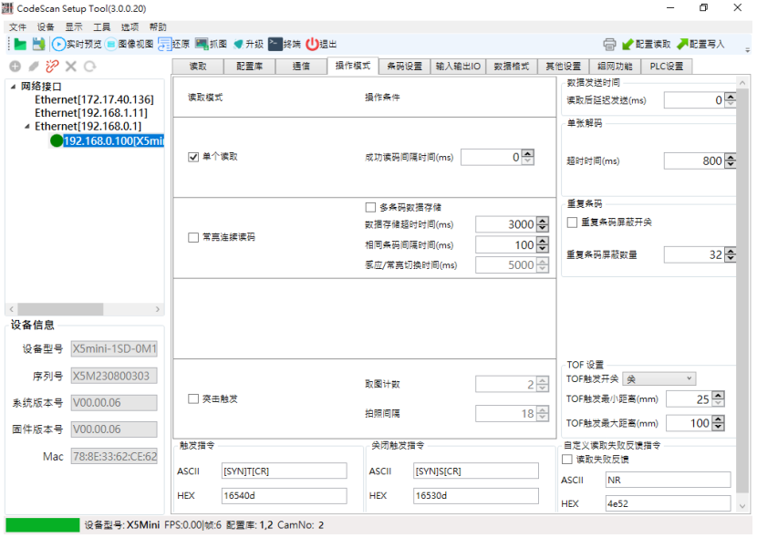
