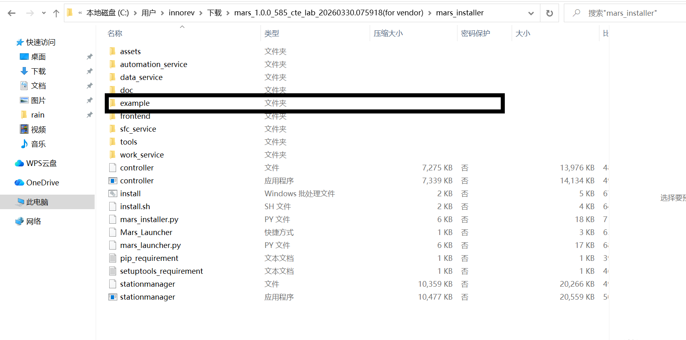
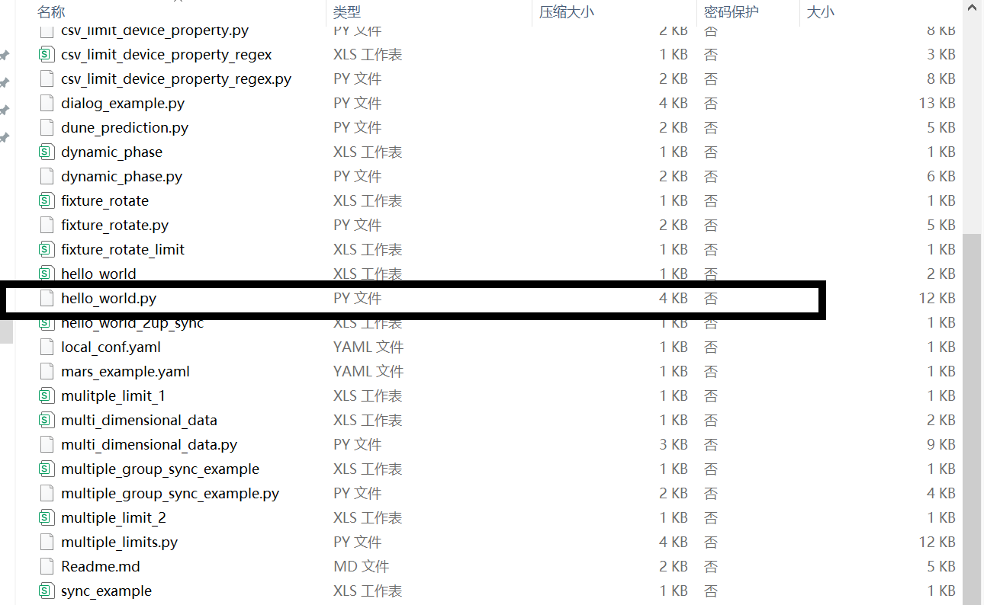
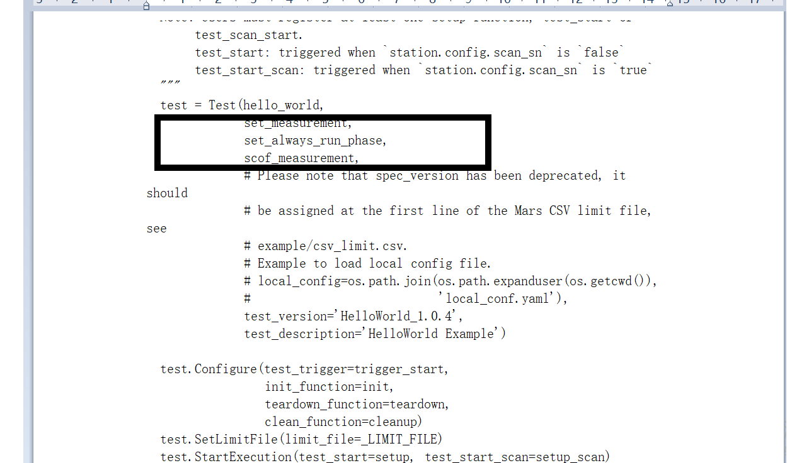
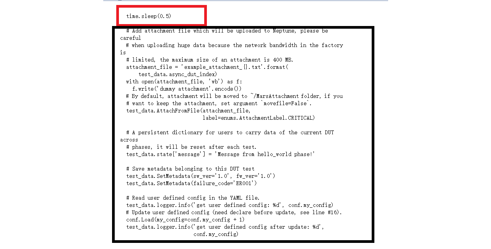

### 1.Sửa lỗi / Cấu hình lại Host IP trong sources.list (Ubuntu)

Cập nhật file sources.list chính:
Bash
```
sudo sed -Ei.bak 's|http://([0-9]{1,3}\.){3}[0-9]{1,3}/ubuntu|http://archive.ubuntu.com/ubuntu|g' /etc/apt/sources.list
```
Cập nhật các file bổ sung trong thư mục sources.list.d:
Bash
```
sudo sed -Ei.bak 's|http://([0-9]{1,3}\.){3}[0-9]{1,3}/ubuntu|http://archive.ubuntu.com/ubuntu|g' /etc/apt/sources.list.d
````
💡 Giải thích chi tiết lệnh:
sed -Ei.bak:

-E: Sử dụng biểu thức chính quy mở rộng (Extended Regular Expressions).

-i: Chỉnh sửa trực tiếp trên file gốc.

.bak: Tự động tạo một bản sao lưu (backup) của file trước khi thay đổi (phòng trường hợp lỗi).

's|...|...|g': Cú pháp tìm kiếm và thay thế toàn bộ (g - global) các chuỗi khớp với mẫu biểu thức chính quy IP (([0-9]{1,3}\.){3}[0-9]{1,3}) thành archive.ubuntu.com.


### 2. Hướng dẫn cài đặt RustDesk trên Ubuntu


🛠️ Các bước thực hiện

Bước 1: Tải xuống bộ cài

Tải tệp cài đặt .deb của RustDesk phiên bản 1.5.0 từ trang phát hành chính thức trên GitHub:

Trang tải xuống [RustDesk v1.5.0 (Anchor Text)](https://github.com/rustdesk/rustdesk/releases/tag/1.5.0)


```cd ~/Downloads
sudo apt update
sudo apt --fix-broken install
```

Bước 3: Cài đặt RustDesk


```
sudo apt install ./ten-file-deb.deb
```

Bước 4: Kiểm tra trạng thái cài đặt

Kiểm tra xem gói phần mềm đã được cài đặt thành công hay chưa bằng lệnh:
```
dpkg -s rustdesk | grep -E "Status|Version"
```


Bước 5: Khởi động ứng dụng

Sau khi cài đặt xong, bạn có thể khởi động giao diện RustDesk trực tiếp từ terminal bằng lệnh:
```
rustdesk
```


Hoặc tìm kiếm **"RustDesk"** trong menu ứng dụng của Ubuntu.

### 3. Sửa lỗi trong Mars. Nếu bị lỗi không test được group (lỗi set_measurement, scof_measurement)


Bước 1: Mở file Mars/example (kịch bản chạy để sửa file hello world)


Bước 2: Mở file hello world.py


Bước 3: Kéo xuống cuối tìm hàm trong main (test = Test(hello_world)), xóa 3 dòng set_measurement, set_always_run_phase, scof_measurement



Bước 4: Search hàm hello_world set time.sleep = 20 và xóa hết nội dung dưới dòng time.sleep trong hàm đó

